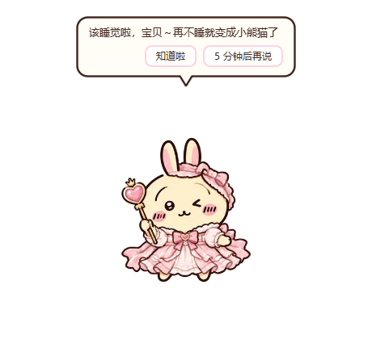
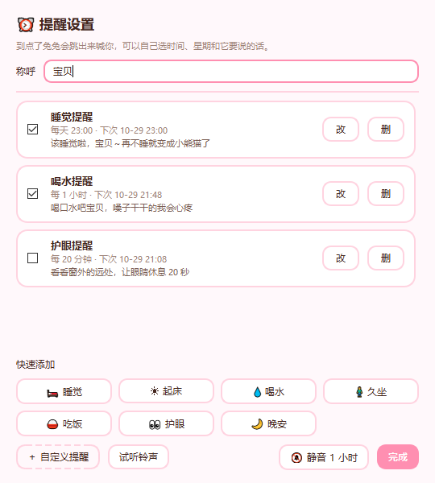
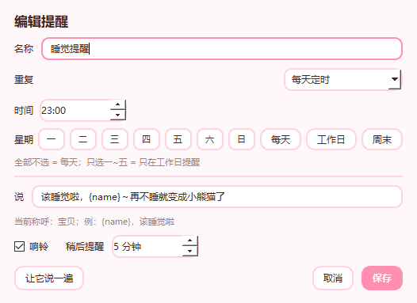
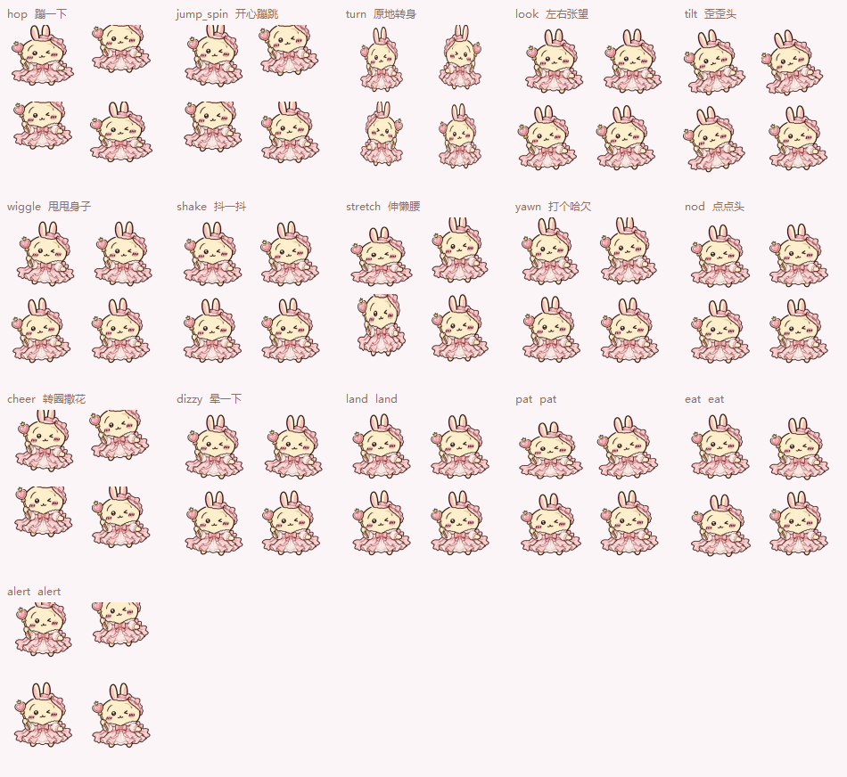
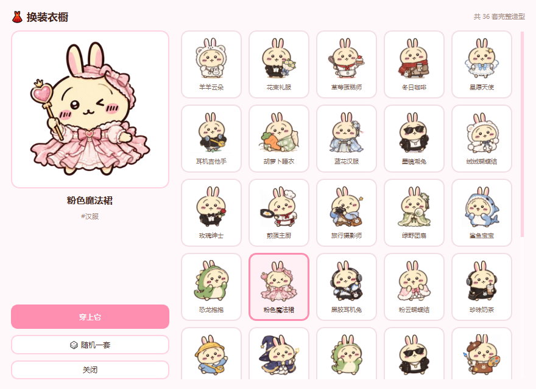

# 兔兔桌宠 · 提醒版

一只会在桌面上陪你的兔兔。它可以定时喊你（或者喊你关心的人）睡觉、起床、喝水、别久坐；你摸它、喂它，它会开心地蹦。

在「36 套换装版」的基础上重做：保留全部原有玩法，新增**提醒系统**和**程序化动作系统**。



## 下载即用

直接下仓库里的 `dist/兔兔桌宠_提醒版.exe`（页面上点 **Download raw file**），双击运行，无需安装 Python。
Windows 10 / 11，单文件，约 49 MB。

## 提醒功能

右键兔兔 →「⏰ 提醒」→「提醒设置…」（托盘图标里也有入口）。

- **称呼**：填「宝贝 / 小李 / 妈妈」，提醒文案里写 `{name}`，到点自动替换
- **快速添加**：🛏 睡觉 23:00 · ☀ 起床 07:30 · 💧 喝水每 60 分钟 · 🧍 久坐每 45 分钟 · 🍚 吃饭 · 👀 护眼 · 🌙 晚安
- **自定义**：名称、时间、星期（可只选工作日 / 周末）、它要说的话
- **两种类型**：每天定时（23:00 这种）／每隔一段时间（喝水、久坐）
- **到点时**：蹦一下 + 响铃 + 气泡说话，气泡上有「知道啦」「5 分钟后再说」（分钟数可改）
- 右键菜单里点一条提醒 = 直接开 / 关；「静音」期间只记录不打扰

细节：到点后 10 分钟内都算数（电脑刚从睡眠里醒来也能补上）；隐藏到托盘时提醒照样会出来；首次运行预置 3 条示范提醒。





## 动作系统

素材每套只有一张静态立绘，所以动作是**程序化**生成的：绘制时施加位移、挤压拉伸、旋转、横向翻转，再叠一层粒子特效。36 套衣服全部通用，不用重画。

| 待机动作（自己玩，10~20 秒一个） | 互动动作（你碰它才触发） |
|---|---|
| 左右张望 · 歪歪头 · 甩甩身子 · 抖一抖 | 摸头 → 先缩再舒服地晃，头上冒爱心 |
| 原地转身 · 点点头 · 蹦一下 | 喂胡萝卜 → 一口一口点头，嘴边冒胡萝卜 |
| 伸懒腰 · 打哈欠 | 双击 → 跳更高，空中转半圈 |
| 常驻呼吸起伏；睡觉时慢呼吸 + 冒 z | 拖动 → 随手的横向速度歪过去；松手 → 压扁回弹 + 扬灰 |
| | 提醒到点 → 弹起 + 甩两下 + 感叹号 |
| | 专注完成 → 原地撒花转圈 |

右键 →「🎬 表演动作」可随时手动点播 12 个动作。




## 其他玩法

- 换装衣橱：36 套造型，实时预览、随机一套
- 摸摸头 / 喂根胡萝卜，5 级亲密度
- 专注计时（番茄钟）15 / 25 / 45 分钟
- 跟随鼠标、自由散步、偶尔自言自语、窗口置顶、三档大小、托盘常驻
- 自由散步与开机自启都默认关闭：散步要手动点开（每次启动都从静止开始），
  程序不会把自己写进开机启动项
- 拖动会掉落 + 弹跳，双击蹦跳



## 从源码运行

### lolPing 信号与表情

兔兔右键或托盘菜单中选择「lolPing」，可打开设置、切换信号和表情、进入联机房间或重启输入监听。新设置默认信号大小为 60，并自动加入 `PING-0GC4M-3WEW8` 房间；之后可在设置里更改。默认快捷键以设置页面为准；全屏游戏建议使用窗口化或无边框模式。退出兔兔时也会关闭 lolPing。

lolPing 使用独立设置，保存在程序目录的 `data/lolping/`，不会修改其他桌宠的设置。源码运行需要 Windows Electron 43.3.0：默认读取 `%USERPROFILE%\.dsh\electron\electron.exe`，也可用 `TUTU_ELECTRON` 指定可执行文件。打包时设置 `TUTU_ELECTRON_DIR` 指向完整 Electron 目录（默认同上），运行组件将打包到 EXE 中。详见 [来源与许可证](runtime/lolping/lolping/README.md)：代码采用上游 MIT 许可证，游戏素材保留原有版权说明。

联机房间支持同步自定义图片，以及不超过 5 MiB 的 GIF 和动态 WebP。双方需要使用支持动图同步的版本；首次加载或对方使用旧版本时会显示静态图。互联网动图使用 WebRTC，默认启用，可在房间设置中关闭；直连可能让房间双方看到彼此的 IP 地址，默认 STUN 服务由 Google 提供，部分网络可能需要 TURN 才能连接。自定义表情声音仅在本机播放。

没装 Electron 也没关系：兔兔照常启动，lolPing 子菜单里会显示「（未安装 Electron 运行组件）」，点其它项才会在气泡里提示缺什么，不会弹窗打断你。

需要 Python 3.10+ 和 PySide6。

```bash
pip install pyside6 pillow
python app/pet.py
```

## 自己打包 exe

```bash
pip install pyinstaller
python build.py          # 产物在 dist/兔兔桌宠/，请保留整个目录
```

## 目录结构

```
app/
  pet.py        主窗口：绘制、物理、菜单、托盘、事件
  motion.py     动作系统：15 个姿态函数 + 粒子 + 播放器
  reminders.py  提醒存储 / 编辑窗口 / 调度引擎
  wardrobe.py   换装衣橱
  theme.py      配色、文案、样式表、配置读写、音效
  assets/       36 套立绘 + 图标 + 衣柜配置
build.py        打包脚本
docs/           README 用的截图
```

## 数据文件

- `pet_config.json`：穿搭、亲密度、位置、窗口大小等（与旧版换装版通用）
- `reminders.json`：提醒清单与称呼

两个文件都生成在 exe 旁边；删掉就会恢复默认。

## 说明

立绘素材：本项目 36 套造型由使用者提供的 4 张 3×3 九宫格图切片而成，并做了**本体归一化**——先边缘洪水填充去绿底，再按「头宽」统一缩放（目标头宽 250px）、头心对齐画布中线、脚底对齐同一条基线（y=344），所以换装时脸的大小和站立高度不会跳。脚本见 `tools/slice_outfits.py`。程序本身是在原版「兔兔桌宠 · 换装版 36 套」基础上重写的提醒 + 动作实现，仅供个人使用与学习。
